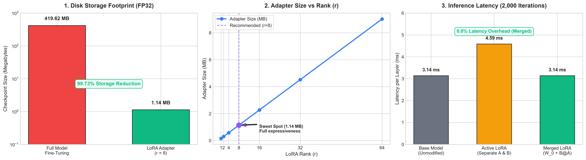

# How a 1.2 MB LoRA Adapter Fine-Tunes a 110M Parameter AI

<p align="center">
  <a href="https://colab.research.google.com/github/TfMarra5/bertimbau-lora-helpdesk/blob/main/notebooks/lora_training_colab.ipynb">
    
  </a>
  <a href="https://github.com/TfMarra5/bertimbau-lora-helpdesk/actions/workflows/ci.yml">
    
  </a>
  
  
  
  
  
</p>

An educational machine learning project exploring **Low-Rank Adaptation (LoRA)** for parameter-efficient fine-tuning of **BERT**, a Transformer model with approximately 110 million parameters.

The project implements LoRA from scratch using PyTorch, fine-tunes `bert-base-uncased` for IT helpdesk ticket classification using Hugging Face PEFT, and provides an interactive Gradio interface.

In the current configuration, only **0.27% of model parameters are trainable**, and the resulting LoRA adapter occupies approximately **1.2 MB**, compared with approximately **440 MB** for the base BERT model weights.

**Project Status:** Experimental prototype — not production-ready.

---

## 📌 Project Overview & Use Case

This project explores automated intent classification and ticket routing for enterprise **IT Helpdesk** requests.

It classifies incoming support tickets into six categories:

- 🔑 `PASSWORD_RESET` — Expired passwords, account lockouts, and credential recovery.
- 🔒 `ACCESS_ISSUE` — VPN authentication, shared folder permissions, and authorization errors.
- 🖥️ `HARDWARE_FAILURE` — Monitor failures, laptop boot problems, and malfunctioning peripherals.
- 📦 `SOFTWARE_INSTALL` — Software installation, deployment, and provisioning requests.
- 🌐 `NETWORK_LATENCY` — Slow connections, Wi-Fi instability, packet loss, and connectivity issues.
- ❓ `GENERAL_QUERY` — IT policies, equipment procedures, support SLAs, and general technical questions.

The objective is to demonstrate how parameter-efficient fine-tuning can adapt a general-purpose language model to a specialized classification task without updating all its parameters.

The current implementation uses **English BERT (`bert-base-uncased`)**, not Portuguese BERTimbau.

---

## 🧠 Mathematical Foundation

In standard full fine-tuning, the model's trainable weight matrices are updated during optimization.

A weight update can be expressed as:

$$
W = W_0 + \Delta W
$$

Where:

- $W_0$ represents the original pretrained weights.
- $\Delta W$ represents the learned weight update.
- $W$ represents the updated weight matrix.

For a BERT-base model with approximately 110 million parameters, storing a full FP32 model checkpoint requires roughly 440 MB.

### Low-Rank Adaptation (LoRA)

LoRA, introduced by Hu et al. (2021), approximates the weight update using two smaller trainable matrices:

$$
\Delta W = \frac{\alpha}{r}(BA)
$$

Where:

- $A \in \mathbb{R}^{r \times d_{in}}$ is a low-rank projection matrix.
- $B \in \mathbb{R}^{d_{out} \times r}$ projects the representation back to the original dimension.
- $r$ is the adaptation rank.
- $\alpha$ is the LoRA scaling parameter.

For the standard initialization used in this project:

- Matrix $A$ is initialized with random values.
- Matrix $B$ is initialized to zero.
- The initial LoRA update is therefore zero: $\Delta W = 0$.

This allows the pretrained weight matrix to remain unchanged at the beginning of fine-tuning.

### Example: Rank-8 Adaptation

```text
            Original Weight Matrix
                W₀ (768 × 768)
                       |
                    Frozen
                       |
                       +
                       |
          B (768 × 8) × A (8 × 768)
                       |
                    Trainable
                       |
               LoRA Weight Update
```

For a single 768 × 768 linear layer:

```text
Full weight matrix: 768 × 768 = 589,824 parameters

LoRA matrix A:      8 × 768 = 6,144 parameters
LoRA matrix B:      768 × 8 = 6,144 parameters

Total LoRA:         12,288 parameters
```

This is a reduction in trainable parameters for that layer, while the original pretrained weights remain frozen.

The project includes a pure PyTorch implementation in `src/lora_scratch.py`, alongside the Hugging Face PEFT implementation used for BERT fine-tuning.

**Reference:** [LoRA: Low-Rank Adaptation of Large Language Models](https://arxiv.org/abs/2106.09685)

---

## 📊 Parameter Efficiency & Benchmarks

### Actual Fine-Tuning Configuration

The following parameter counts were reported by the project's training pipeline:

| Metric | Value |
| :--- | ---: |
| Base Model | `bert-base-uncased` |
| Fine-Tuning Method | LoRA (PEFT) |
| LoRA Rank | 8 |
| LoRA Alpha | 16 |
| Total Model Parameters | 109,786,380 |
| Trainable Parameters | 299,526 |
| Percentage Trainable | 0.2728% |
| LoRA Adapter Checkpoint | 1,204,976 bytes |
| Adapter Size | Approximately 1.2 MB (1.15 MiB) |
| Base BERT Weights | Approximately 440 MB |

The results demonstrate that the model can be adapted by training a small subset of its parameters.

The adapter checkpoint is much smaller than a full model checkpoint, but using it for inference still requires access to the pretrained base model.

### Computational Benchmarks

<p align="center">
  
</p>

The repository includes a benchmarking script that compares a standard linear layer, an active LoRA layer, and a merged LoRA layer.

Previously reported benchmark values:

| Metric | Base Layer | LoRA Active | LoRA Merged |
| :--- | ---: | ---: | ---: |
| Layer Latency | 3.14 ms | 4.59 ms | 3.14 ms |
| Relative Latency | Baseline | +46.1% | 0.0% measured overhead |

**Benchmark note:** These values come from an earlier reported layer-level experiment using 2,000 iterations. They have not yet been independently reproduced in the current environment.

They should not be interpreted as end-to-end BERT inference latency measurements.

### Weight Merging

LoRA introduces an additional low-rank computation while the adapter is active.

When supported, the trained adapter can be merged into the original weight matrix:

$$
W_{\text{merged}} = W_0 + \frac{\alpha}{r}(BA)
$$

After merging, an equivalent linear operation can run without separately computing the LoRA update.

This can eliminate the additional LoRA matrix operations for the merged layer, although actual inference latency depends on hardware, implementation, and deployment conditions.

### Rank ($r$) Scaling Study

Previously reported adapter storage estimates for different LoRA ranks:

```text
r=1  : 0.16 MB
r=2  : 0.30 MB
r=4  : 0.58 MB
r=8  : 1.14 MB  <-- Configuration used in this project
r=16 : 2.27 MB
r=32 : 4.52 MB
r=64 : 9.02 MB
```

These figures illustrate how adapter storage requirements scale with rank.

Rank 8 was selected for the current experiments. It has not yet been established as the optimal rank for this classification task.

The benchmark and rank study can be rerun using the scripts provided in the repository.

---

## 🎯 Classification Results

The BERT + LoRA classifier was trained and evaluated using a small labeled IT helpdesk dataset.

### Dataset

The dataset contains 90 English-language helpdesk tickets distributed evenly across six categories.

| Category | Examples |
| :--- | ---: |
| `PASSWORD_RESET` | 15 |
| `ACCESS_ISSUE` | 15 |
| `HARDWARE_FAILURE` | 15 |
| `SOFTWARE_INSTALL` | 15 |
| `NETWORK_LATENCY` | 15 |
| `GENERAL_QUERY` | 15 |
| **Total** | **90** |

The training pipeline uses stratified training, validation, and test splits.

| Dataset Split | Examples |
| :--- | ---: |
| Training | 63 |
| Validation | 13 |
| Test | 14 |

No duplicate texts were found during the initial dataset inspection.

However, the absence of exact duplicates does not guarantee the absence of semantically similar examples.

### Training Configuration

| Parameter | Value |
| :--- | :--- |
| Base Model | `bert-base-uncased` |
| Framework | PyTorch |
| Fine-Tuning Library | Hugging Face PEFT |
| LoRA Rank | 8 |
| LoRA Alpha | 16 |
| Batch Size | 8 |
| Epochs Compared | 1 and 20 |
| Model Selection Metric | Validation Macro F1-Score |
| Evaluation Metrics | Accuracy, Macro Precision, Macro Recall, Macro F1 |

### Preliminary Test Results

Two exploratory training runs were performed:

| Metric | 1 Epoch | 20 Epochs |
| :--- | ---: | ---: |
| Accuracy | 7.14% | 57.14% |
| Macro Precision | 2.08% | 63.89% |
| Macro Recall | 8.33% | 61.11% |
| Macro F1-Score | 3.33% | 59.44% |

The 20-epoch run correctly classified 8 of the 14 test tickets.

These results suggest that additional training helped the classifier learn patterns from the dataset.

However, the experiments were exploratory and were completed before an explicit random seed was added to the training pipeline.

The results should not be interpreted as a controlled hyperparameter study or as a reliable estimate of performance on real-world enterprise support tickets.

### Reproducibility

The training pipeline now sets a fixed random seed of 42 to improve experiment reproducibility.

It also selects the best checkpoint based on validation macro F1-score and evaluates the selected model on a separate test split.

A fixed random seed improves consistency but does not guarantee fully deterministic results across all hardware and software environments.

The preliminary results reported above have not yet been reproduced under the updated configuration.

### Limitations

- The dataset contains only 90 examples.
- Each class contains only 15 examples.
- The test set contains only 14 examples.
- Some tickets may be ambiguous between related categories.
- The model has not been validated on a larger independent dataset.
- The test set has already been examined during exploratory development, limiting its use for unbiased final evaluation.
- The application can fall back to rule-based demonstration predictions when a trained model is unavailable.
- The project uses English BERT rather than Portuguese BERTimbau.
- The implementation is experimental and should not be considered production-ready.

Future improvements will focus on dataset expansion, clearer labeling rules, robust error analysis, and reproducible evaluation.

---

## 📂 Repository Structure

```text
bertimbau-lora-helpdesk/
├── .github/
│   └── workflows/
│       └── ci.yml                  # Automated tests
├── assets/
│   └── benchmark_summary.png       # Benchmark visualization
├── data/
│   └── helpdesk_dataset.json       # Labeled helpdesk tickets
├── notebooks/
│   └── lora_training_colab.ipynb   # Google Colab notebook
├── src/
│   ├── __init__.py
│   ├── app.py                      # Gradio interface
│   ├── benchmark.py                # Latency and parameter benchmarks
│   ├── inference.py                # CLI inference
│   ├── lora_scratch.py             # Manual PyTorch LoRA implementation
│   ├── rank_ablation.py            # LoRA rank study
│   └── train.py                    # Training and evaluation pipeline
├── tests/
│   └── test_lora.py                # LoRA unit tests
├── .gitignore
├── CHANGELOG.md                    # Version history
├── LICENSE                         # MIT License
├── pyproject.toml                   # Project metadata and dependencies
├── README.md                        # Project documentation
└── requirements.txt                 # Package dependencies
```

---

## 🚀 Quick Start

### 1. Run in Google Colab

Open the notebook:

[Open in Google Colab](https://colab.research.google.com/github/TfMarra5/bertimbau-lora-helpdesk/blob/main/notebooks/lora_training_colab.ipynb)

The notebook provides an alternative environment for exploring LoRA fine-tuning.

Its workflow may differ from the current local training pipeline.

### 2. Local Installation

Clone the repository:

```bash
git clone https://github.com/TfMarra5/bertimbau-lora-helpdesk.git
cd bertimbau-lora-helpdesk
```

Create a virtual environment:

```bash
python -m venv venv
```

Activate it on Windows PowerShell:

```powershell
.\venv\Scripts\Activate.ps1
```

Or on Linux/macOS:

```bash
source venv/bin/activate
```

Install project dependencies:

```bash
python -m pip install -e ".[dev]"
```

The project has been tested locally using Python 3.12.

GPU training requires a CUDA-enabled PyTorch installation compatible with the system's NVIDIA driver and hardware.

### 3. Run Unit Tests

```bash
python -m pytest tests/ -v
```

The project includes tests covering:

- LoRA parameter reduction.
- Zero-update initialization.
- Weight merging equivalence.

### 4. Explore LoRA from Scratch

```bash
python src/lora_scratch.py
```

### 5. Run Benchmarks

```bash
python src/benchmark.py
```

### 6. Run Rank Ablation

```bash
python src/rank_ablation.py
```

### 7. Train the Model

Example training configuration:

```bash
python src/train.py --base_model bert-base-uncased --epochs 20 --batch_size 8 --rank 8 --output_dir checkpoints/experiment-20-epochs
```

The training pipeline performs:

1. Dataset loading.
2. Stratified train/validation/test splitting.
3. Tokenization.
4. BERT model initialization.
5. LoRA adapter configuration.
6. Fine-tuning.
7. Validation and model selection.
8. Independent test-split evaluation.
9. LoRA checkpoint saving.

Training outputs are stored in the specified checkpoint directory.

The checkpoint is an adapter, not a standalone copy of the full pretrained BERT model.

### 8. Launch the Gradio Interface

```bash
python src/app.py
```

The Gradio interface provides an interactive way to classify IT helpdesk requests.

When a compatible trained model checkpoint is available and loads successfully, the interface can use BERT + LoRA predictions.

Otherwise, it may display rule-based demonstration predictions.

The interface identifies the prediction source to distinguish model inference from demo behavior.

---

## 🗺️ Development Roadmap

### v0.1.0 — Initial Prototype

- BERT + LoRA classification pipeline.
- Manual LoRA implementation.
- Gradio interface.
- Automated LoRA tests.
- Stratified data splitting.
- Preliminary classification evaluation.
- Initial experiment reproducibility improvements.

### v0.2.0 — Dataset Improvement (Planned)

- Expand the helpdesk ticket dataset.
- Define consistent category labeling rules.
- Include more realistic and diverse ticket descriptions.
- Improve handling of ambiguous requests.
- Prepare new independent evaluation data.

### v0.3.0 — Evaluation & Benchmarking (Planned)

- Establish reproducible experiment configurations.
- Compare LoRA ranks and training configurations.
- Analyze per-category performance.
- Generate confusion matrices and error reports.
- Revalidate model and layer-level benchmarks.

### v1.0.0 — Stable Release (Long-Term Goal)

- Validated classification pipeline.
- Documented model limitations.
- Improved inference reliability.
- Reproducible training workflow.
- Comprehensive documentation and tests.

Planned versions are development goals and do not represent committed release dates.

---

## 📄 License

This project is distributed under the **MIT License**.

See the [LICENSE](LICENSE) file for the full terms.

The MIT License allows others to use, modify, distribute, and commercially use the project's licensed code, provided that the required copyright and license notices are preserved.

Third-party dependencies, pretrained model weights, and externally sourced assets may be subject to their own license terms.

---

## 📚 References

1. Hu, E. J., et al. (2021). [LoRA: Low-Rank Adaptation of Large Language Models](https://arxiv.org/abs/2106.09685).
2. Devlin, J., et al. (2018). [BERT: Pre-training of Deep Bidirectional Transformers for Language Understanding](https://arxiv.org/abs/1810.04805).
3. Hugging Face. [PEFT Documentation](https://huggingface.co/docs/peft/index).
4. Hugging Face. [Transformers Documentation](https://huggingface.co/docs/transformers/index).
5. PyTorch. [Official Documentation](https://docs.pytorch.org/docs/stable/index.html).

---

**Project:** [BERT + LoRA Helpdesk](https://github.com/TfMarra5/bertimbau-lora-helpdesk)

**Current Status:** Experimental ML Prototype
